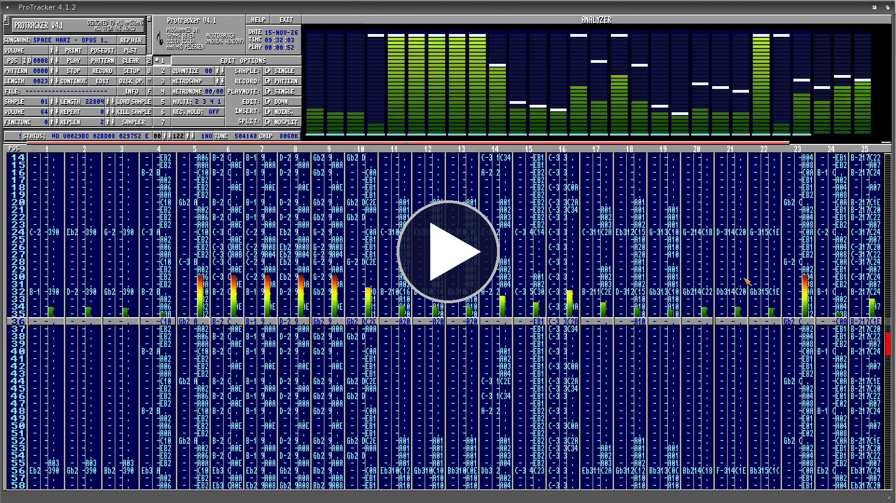
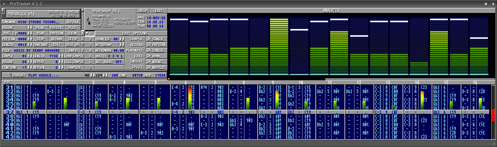
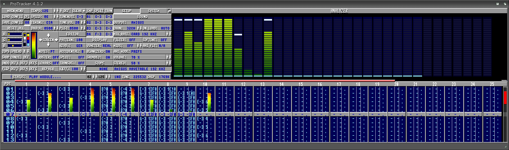
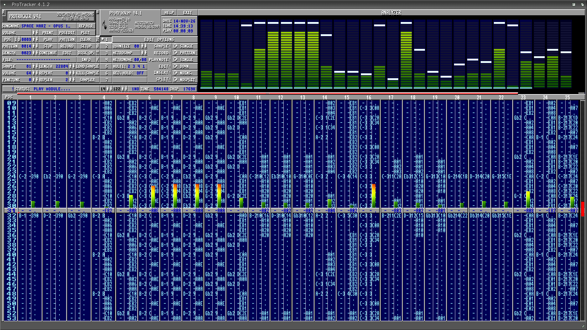
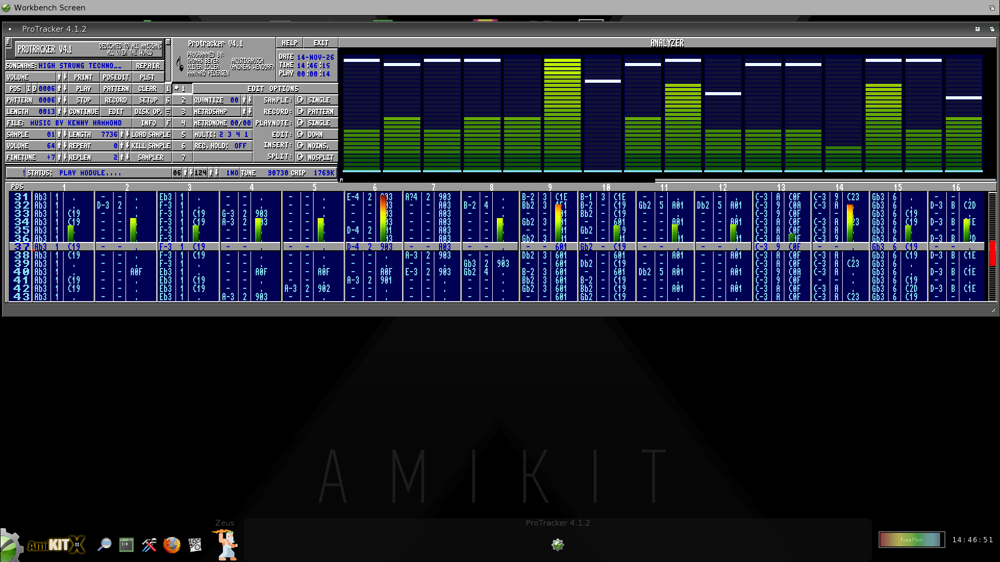
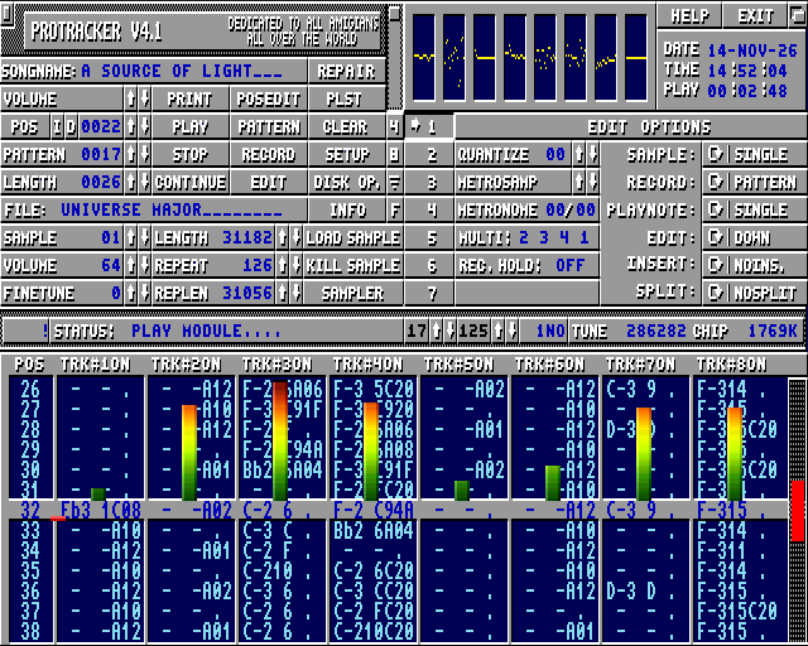
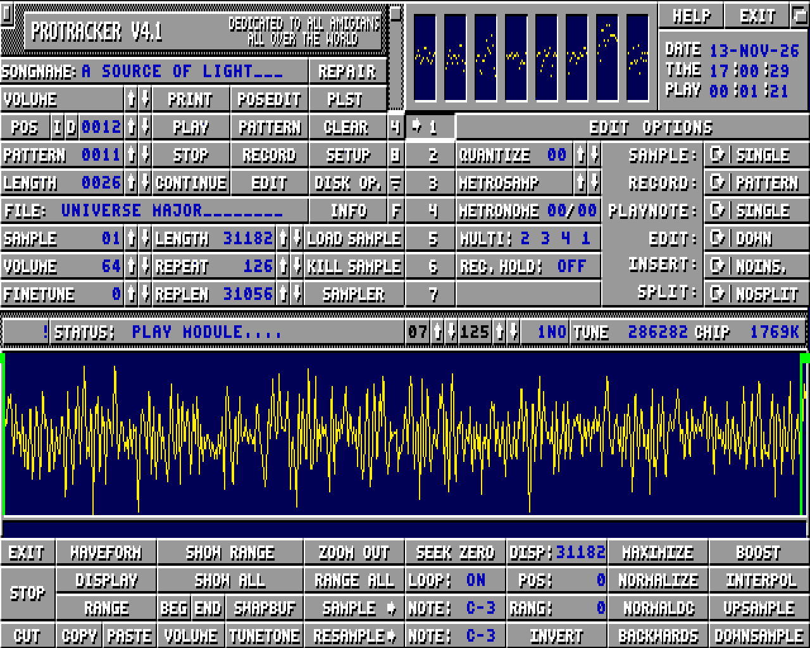
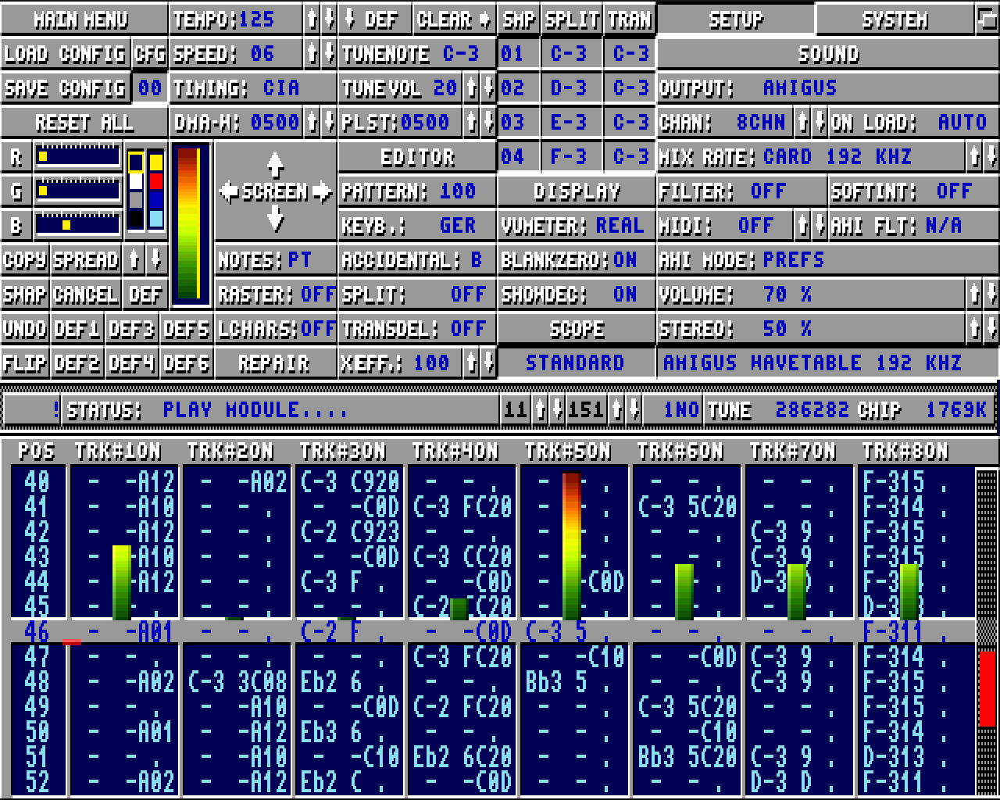

# ProTracker 4.1.2

Amiga music tracker. 68000 to 68060, Kickstart 2.04 or newer, 1 MB chip RAM.
By Tom Beyer, Oliver Ickler, Haavard Pedersen and Akustikrausch (Andreas Wendorf), 2026.

*Video on YouTube: Space Warz - Opus 1 by Rez of Eclipse, 28 channels, in the
RTG window on a Full HD Workbench.*

ProTracker 4.1.2. Up to 32 channels, graphics cards, sound cards, and the
editor you know.

Get it from Aminet (`mus/edit/ProTracker-4.1.lha`) or from the releases on
GitHub. Keep your old ProTracker and work on copies of important songs.

## what it does

- Pattern editor for 1 to 32 tracks (9 to 32 with the AmiGUS), 64 rows, up
  to 100 patterns, song position list, PLST, edit options: quantize,
  metronome, multi keyboard, record hold, sample / record / playnote / edit /
  insert / split modes.
- Edit op. pages with tools for tracks, patterns and samples, filter editor
  with modulation curve, chords, MIX IT (tracks rendered to a sample).
- Sample editor: maximize, normalize, normal dc, boost, interpol, upsample,
  downsample, resample, backwards, invert, tunetone, zoom, ranges, cut / copy
  / paste. Sampler with monitor. Volume envelopes (DYN, UNDYN).
- Disk op with long names, module / song / sample / track / pattern saving,
  SAVE EXE writes a module as a standalone player.
- Scopes, analyzer and VU meters, palette editor, 6 colour presets, online
  help, config slots.

## new in 4.1.2

New, most important first:

- **AmiGUS sound card output**, every track on its own voice of the card
  (see below). Picked by itself at the first start.
- **Modules with 1 to 32 channels.** 9 to 32 channels need the AmiGUS. With a
  graphics card all tracks are shown side by side, without one 8 tracks are
  in view and a slider scrolls through the rest. All tracks can be edited
  (patterns, mute per channel, undo). SETUP -> CHAN sets the track count: 1
  to 32 with the AmiGUS, else 1 to 8.
- **Up to 63 samples per module.** Samples 1-31 are stored as in any MOD,
  32-63 follow in a block at the end; players that ignore trailing data play
  1-31.
- **Mute per channel:** every channel 1-32 can be switched off with its
  track head, on the normal screen and in the RTG window.
- **RTG window layout:** the tracks share the window width, the analyzer
  shows an LED chain per channel with peak hold, and every track in view
  has its own level bar. The window's close gadget works like the exit
  button of the page shown (quit request, close help, back to the main
  page).
- **Smooth RTG window dragging:** PT no longer slows the moving of other
  windows.
- **4 channel modules load in 4 channel mode** (SETUP -> ON LOAD), so they
  play on Paula directly without the mixer.
- **Pattern view drawn on the graphics card:** a 68020 at 14 MHz went from
  1-2 to 15-18 frames per second while playing.
- MIDI in, notes outside C-1..B-3, the Amiga output filters for AHI cards,
  modules with 1-7 channels keep their track count, a marker at the end of
  modules that use 4.1 extras.

Fixed, most important first:

- Editing on tracks 5-8 in 8 channel mode wrote into the wrong track or row
  (notes, record, rows, blocks, undo).
- Paula played only noise after AHI or AmiGUS output: the samples were in
  fast RAM, which Paula cannot read.
- XPK packed modules: every loop was stretched to the sample end and one-shot
  samples looped.
- AmiGUS on fast CPUs (PiStorm): the card stayed silent after the samples
  were sent too fast.
- AmiGUS with wide modules: STOP left voices playing; loops with a start
  above 0, loops and 9xx beyond 64 KB, notes outside C-1..B-3 and 8xx
  (panning only) sounded wrong.
- Editing wide modules: added patterns, group changes, mute and undo put
  cells on the wrong tracks.
- Memory overwrites when loading damaged modules and in UPSAMPLE, MIX,
  DOWNSAMPLE and CUT BEG; a sample that did not fit lost the old one;
  overwriting a file on a full disk now keeps the old file.
- AmiGUS: STOP and loading a module silence every voice at once (a looped
  sample could keep beeping).
- Crash on a second start.
- AHI: a short dropout every few minutes (sound card and Amiga clock drift
  apart); the right side was missing in plain stereo modes. The mixer now
  runs at the rate the AHI driver really plays; silent AHI falls back to
  22 kHz, then to Paula.
- SAVE EXE writes up to 8 channels; for a 9-32 channel module it says so
  and writes nothing.
- 68000: crash on Cursor Right. Graphics card: freeze when changing the
  aspect or resizing the window while playing.

The full list is in `WhatsNew.txt` in the archive.

## AmiGUS sound card

With an AmiGUS card and `amigus.library` installed, SETUP -> OUTPUT ->
AMIGUS plays every track on its own voice of the card's wavetable. Nothing
is mixed in software, so this also works on a 68000.

- The first start picks the card by itself, before AHI and Paula, also
  when AHI is set up for the card.
- Samples are copied to the card's memory when a module is loaded or a
  sample changes. Loops, backwards play (81y), DYN envelopes and 9xx are
  implemented as on Paula; the per-tick checks ran against an emulated card.
- Modules with 9 to 32 channels (9CHN, 10CH .. 32CH) play only on the
  AmiGUS; otherwise they are not loaded. With a graphics card the window
  widens by itself when such a module is loaded and shows the tracks side
  by side: 16 at 1280 pixels, 25 on a Full HD Workbench, all 32 from about
  2370 pixels. Shift + mouse wheel or the red bar above the track heads
  scrolls by four tracks. Without a graphics card the normal screen shows 8
  tracks (4 with little memory) and a slider above the heads scrolls
  through the others; Tab and Shift + mouse wheel work too. All tracks can
  be edited and switched off with their head; SAVE MODULE writes them all.
  In the window the tracks share the full width, row numbers on the left.
  Many channels need CPU time: a stock A500+ (chip RAM only) plays 12 to 20
  channels cleanly; with 24 to 32 card updates can lag a tick or two after
  heavy rows. A 68000 with fast RAM is fine at 28.
- Switching OUTPUT away from AMIGUS with such a module asks first and keeps
  tracks 1-8.
- The card's own mixer settings (AmiGUS Mixer) are left as they are.
- Tested on a real A1200 with PiStorm32 lite and an AmiGUS mini, with real
  modules of 6 to 32 channels. Not every effect has been heard on the real
  card.
- Known limit: 24-32 voices can clip on the card, there is no volume
  reduction yet.

## since 4.1

- **8 channels.** 8CHN, OCTA, CD81 and FLT8 load, play and save. 68020 and up
  mix all eight at 22-28 kHz, a fast 68000 plays 1+2 on paula and mixes the
  rest, a 7 MHz A500 with fast ram mixes at 5 kHz. 8 channel mode is the
  default wherever the machine can take it.
- **VU meters and analyzer for all eight tracks**, side by side.
- **Runs on a plain 68000** (A500+, 1 MB) and up to the 68060.
- **Graphics cards (RTG).** Own card screen, or a window on a graphics card
  workbench that snaps to whole sizes (Amiga 1:2 or square pixels) and
  shows more pattern rows when it is taller. The pattern area is drawn on
  the card itself, so playing stays smooth even on a 68020.
- **Sound cards (AHI).** 16 bit stereo through any AHI driver, picked
  automatically when AHI is installed, switchable while a song plays.
- **First start sets itself up:** cpu, sound and graphics are detected.
- WAV and AIFF samples (8/16 bit, mono/stereo), XPK packed files,
  partitions in the terabyte range.
- New effects 81y-87y: play backwards, blend track pairs and more.
- SAVE EXE and MIX IT in 8 channel mode, MIX IT without extra library.
- Setup in two pages (SETUP / SYSTEM), colour scheme 4.1 or the classic 2.3
  look, tempo changes timed like ProTracker 2.3D.
- Getting started page in the help, AmigaGuide manual.
- A long list of fixes against 4.0: scope hang, requester lockups,
  big directories, truncated modules and more.

## ProTracker 2.3D compatibility

4 channel modules play like in ProTracker 2.3D, and I check that with a
measurement, not by ear. Both trackers play the same module in the emulator,
and a small spy program reads the channel state of each tracker every frame
(note, effect, period, volume). The two sequences are compared per channel.

- Mass test: 175 modules, 162 equal over the first 39.5 seconds. The rest are
  modules where 2.3D itself stops updating (the scope bug that 4.1 fixed) and
  one test setup issue.
- Fixed on the way: tempo changes (Fxx) now take effect at the next timer
  tick like in 2.3D, and the scope no longer hangs on very low periods.
- A reference set of 8 modules (tempo changes, effects, game and demo
  music) is compared against stored 2.3D recordings in every regression run
  before a release.

Known differences:
- tre_nox (J0rMaS): 2.3D drops the first six hi-hats on channel 4, 4.1 plays
  them as written in the module.
- epilepsey (HaRDc0re): fast period changes make the per-frame sampling jitter
  by 3-5 frames in both directions. That is the measurement, not the replay,
  so this module is not in the reference set.
- 8 channel modules: 2.3D has no 8 channel mode.

## requirements

- 68000 to 68060, Kickstart 2.04 or newer (tested up to AmigaOS 3.2.3), 1 MB
  chip RAM. 4 channel modules play on every such Amiga.
- 8 channels on Paula: a 68020 or a fast 68000 mixes tracks 5-8. A 7 MHz
  68000 needs real fast RAM for that (5 kHz, no scopes while playing);
  512 KB trapdoor slow RAM does not count. Otherwise tracks 1-4 play.
- AHI sound cards: 68020 and ahi.device.
- AmiGUS: the card and `amigus.library`, any CPU. 9-32 channel modules need
  the AmiGUS; a graphics card is optional.
- Graphics card (RTG): 68020 and Picasso96 or CyberGraphX
  (cybergraphics.library 40). The card screen needs an 8 bit 640x480 or
  640x512 mode, the window a Workbench on the card. All tracks of a wide
  module side by side need cybergraphics.library 41.
- Optional: xpkmaster.library, powerpacker.library, a MIDI interface on the
  serial port.

| machine | 4.1 does |
|---|---|
| 68000, 7 MHz, 1 MB chip (A500+) | full editor, 4 channels; 8 channels with fast ram at 5 kHz |
| fast 68000 (accelerator) | 8 channels |
| 68020 (A1200) | 8 channels at 22 kHz, AHI, RTG |
| 68030 / 68040 / 68060 | 8 channels at 22-28 kHz (28 from about a 68030 at 50 MHz), AHI, RTG |

With an AmiGUS card nothing is mixed in software, on any CPU. Modules with
9 to 32 channels need the card (a graphics card is optional).

Tested in WinUAE: A500+ with 68000 and 1 MB chip on Kickstart 2.04,
A500 with fast ram, A500 with fast 68000, A1200 on Kickstart 3.1, A1200 on
AmigaOS 3.2.3 with AHI, A4000 with 68040 and 68060, A1200 with Picasso96,
AmiKit 12.1 (AmigaOS 3.2.2) with a full hd card workbench and AHI 6.7.
On real hardware: one A1200 with PiStorm32 lite (Emu68), AmiGUS mini and
AmiKit on a full hd workbench.

Known limits: RTG window dragging can still stall for up to about one
second now and then; overwriting a large file on a nearly full disk fails
and keeps the old file; the PowerPacker password dialog fix is untested.

## get it

`dist/ProTracker-4.1.lha` - unpack, drag the drawer anywhere, run. No installer.

## build it

    vasmm68k_mot -no-opt -Fhunkexe -nosym -kick1hunks -o ProTracker41 Protracker.asm

or `make VASM=/path/to/vasmm68k_mot`. The binary you build is not byte
identical to the one in `dist/` (relocation order, build stamp). vasm (m68k, mot syntax) by Volker
Barthelmann and Frank Wille: http://sun.hasenbraten.de/vasm/

## libpt4

`libpt4/` is a replayer library in portable C99 that plays modules the way
ProTracker 4.1 does: all formats the 4.1 loader takes (4 to 32 channels,
FLT8, 15 samples), samples 32-63, DYN envelopes, the 8xy effects and the
8 channel mixer, compared byte for byte with mix dumps of PT 4.1 itself.
Stereo 16 bit or float at any rate from 8 to 192 kHz, no global state, no
file access, builds with gcc, clang, MSVC (CMake) and vbcc for a 68000
Amiga. Licence: zlib (`libpt4/LICENSE`), so it can go into other players.

    cd libpt4 && make && make test
    build/pt4play module.mod -o out.wav

Format and playback rules: [docs/PT41_FORMAT.md](docs/PT41_FORMAT.md).
API: `libpt4/include/pt4.h`, more in `libpt4/README.md`.

## source

    Protracker.asm      equs, macros, include order
    src/sys/            startup, libs, interrupts, input, cpu, rtg, ahi
    src/engine/         replayer, song control, mixers, effects
    src/io/             disk op, load/save, iff/imp!, formats
    src/ui/             screens, gadgets, editors, sampler, setup, vu
    src/data/           data, chip data, bss, bin/ (graphics, exe player)
    include/            structs
    libpt4/             replayer library in C99 (zlib)
    docs/PT41_FORMAT.md module format and playback rules

## screens

*Space Warz - Opus 1 by Rez of Eclipse, 28 channels on the AmiGUS, the window
filling the Full HD Workbench.*

*ProTracker 4.1.2 in a window on the Workbench, High Strung Techno by Kenny
Hammond.*

*A Source of Light by Dustbin of Nemesis, 8 tracks with scopes.*

*Sampler.*

*Setup.*

## reporting bugs

If you can, try the same in ProTracker 2.3D or 4.0 Beta 2 first: if the old
version does the same, it is original behaviour. A report helps most with:
Amiga model, CPU or accelerator, Kickstart and OS, chip and fast RAM, 4 or 8
channels, OUTPUT and MIX RATE (SETUP), RTG on or off (screen or window, which
card), AHI driver and mode, the module, and the steps that lead to the
problem. Please open an issue here.

## credits

ProTracker 4.1 by Tom Beyer, Oliver Ickler, Haavard Pedersen and Akustikrausch
(Andreas Wendorf). Based on 3.15 by CryptoBurners and ProTracker by Lars Hamre
and Amiga Freelancers. Earlier versions belong to their authors.

## licence

ProTracker (C) 1990 Lars Hamre, 1992-93 CryptoBurners, 1994-98 Tom Beyer,
Oliver Ickler. 4.1 additions (C) 2026 Akustikrausch (Andreas Wendorf). The
original parts stay with their authors; no claim is made on them.

Tom Beyer opened the ProTracker 4 source on Aminet
(mus/edit/PT4_Beta2_src.lha) under this condition: "Using this source code
is allowed as long as the names of *all* developers are visible in the
about requester of the executable." 4.1 keeps it: whoever builds on this
keeps all names in the about box. ProTracker 3.15 was released by
CryptoBurners as public domain.

Free, non-commercial hobby project. Not for sale. No warranty. See LICENSE.
Exception: the 8 channel mixer (src/engine/mixer.asm, mix68k.asm) is also
available under the MIT licence, see LICENSE.

dedicated to all amigans all over the world.
